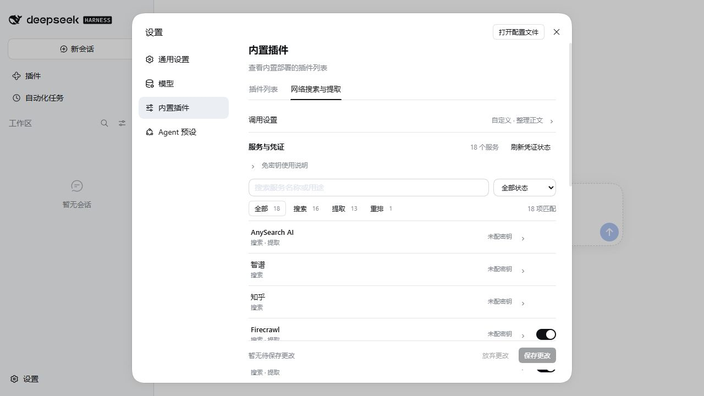
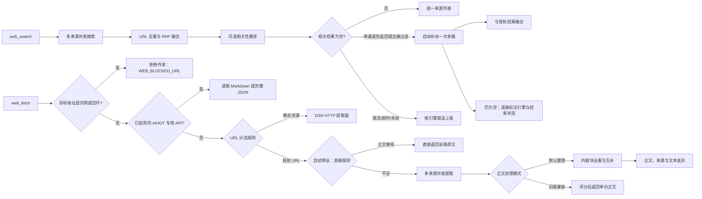

# dsh-web-search-fetch

[](./LICENSE)
[](./package.json)

**面向资料研究的 DSH 插件：融合多来源搜索，整理网页正文，保留来源与差异。**

面向 [DeepSeek Harness](https://github.com/deepseek-ai/deepseek-harness)（DSH）的网络搜索与网页提取插件。它把多个服务聚合到原生 `web_search` / `web_fetch` 两个 provider 后面，不新增模型工具、MCP 服务、常驻浏览器或外部 CLI。新安装默认启用 AnySearch、Firecrawl、Tavily，使用官方匿名额度开始；自动预设默认由本地规则判断调用范围，不需要模型凭证。DSH `0.2.1-rc.2` 新增的 DeepSeek Search / Fetch 直连 API 已作为默认关闭的可选来源接入。配置更多服务后，搜索结果经过 URL 去重与 RRF 融合，动态网页按多路正文整理，并保留来源与差异。

[快速开始](#快速开始) · [项目定位与证据](#项目定位与证据) · [配置参考](./docs/configuration.md) · [正文整理演示](./docs/content-organization.md#输入与输出演示) · [真实对比](./docs/modsearch-comparison.md) · [依赖审阅材料](./docs/dependency-review.md) · [参与贡献](./CONTRIBUTING.md)

```sh
dsh plugin --profile web add https://github.com/qikairo7/dsh-web-search-fetch/releases/download/v0.2.20/dsh-web-search-fetch-0.2.20.tgz
```

安装后打开「设置 → 内置插件 → 网络搜索与提取」，在顶部明确选择一种开始方式：

- **配置自动决策**：展开调用设置，默认的自动预设已经可用；需要让模型参与判断时，把判断方式切换为决策模型，配置对应平台密钥并保存。
- **直接体验匿名服务**：切换为自定义固定预设，仅选择官方端点且未配密钥的推荐服务和直接 HTTP 抓取，关闭其他服务；保存后即可使用，无需任何决策模型凭证。已有密钥与自定义端点不会被清除。

匿名模式受服务方额度与限流约束，不能保证无限使用。未安装 DSH 的环境需先完成[宿主安装](https://github.com/deepseek-ai/deepseek-harness)。

## 项目特点

| 特点 | 当前实现 | 使用价值 |
| --- | --- | --- |
| 多来源搜索融合 | 最多 13 个搜索服务并发调用，合并重复 URL 与已知文档别名，使用 RRF（Reciprocal Rank Fusion）融合排名 | 将多路可用结果整理为统一来源列表 |
| 官方文档优先 | 识别已支持技术项目的官方文档意图，补充限定域名检索；相关官方来源在重排前后优先；该意图同时命中受支持项目时，自动档按多通道派发 | 减少技术检索中官方资料缺失或被无关页面挤占 |
| 无需密钥首次体验 | AnySearch、Firecrawl、Tavily 官方搜索与提取支持匿名额度，无需填写密钥 | 自动与固定预设都不要求决策模型凭证 |
| 两段式提取 | 自动预设在整理模式下先派发一路探测，正文够用就直接返回原文，不合并、不加来源标记 | 短页与常见文章一次请求即可，省额度也省尾部等待 |
| 多来源正文整理 | 动态提取按章节和共同内容块去重、互补，保留提取来源及文本差异 | 将说明、表格、代码和独有段落整理到一份正文 |
| 原生双工具 | 仅注册搜索和提取 provider，不新增模型工具，也不需要额外 MCP 服务、浏览器自动化或外部 CLI | 沿用 DSH 的 `web_search`、`web_fetch` 调用方式 |
| 可选免费重排 | 调用硅基流动免费模型 `BAAI/bge-reranker-v2-m3`；不可用时保留融合顺序 | 对融合候选进行相关性排序，仍需配置 API Key |
| 服务统一管理 | DSH 凭证管理、服务开关，以及超时、取消、限流冷却和额度熔断 | 一处配置搜索、提取与重排；单路失败时继续使用其他可用结果 |
| 调用范围与预算 | 自动预设按本地规则在单通道与多通道之间判断，多路结果充分后经过宽限期结束慢渠道 | 简单问题只用一路，复杂问题才并发；也支持固定预设 |
| 空结果透明与自动补派 | 搜索空结果时逐路标注引擎与结束状态（空返回、被过滤、限流、超时、取消）；单通道空返回自动补派一次多路并融合，补派在说明中可感知 | 区分「查询无解」与「覆盖不足」，单路漏掉的结果自动捞回 |

插件注册两个 ID 为 `aggregated` 的 provider。设置页覆盖 15 项搜索／提取／重排服务和 14 个凭证位，另提供可选的五款决策模型与判断方式切换。每项服务均提供独立启停开关。静态资源使用 DSH 内置 HTTP 提取器，AIHOT 专用 API 直接读取；其余 URL 按配置进入多服务提取。

动态网页提取默认将同一 URL 的多路结果整理成一份正文：按章节和共同段落去重，补充独有内容，保留提取来源和文本差异。代码、表格、链接和原文数字保留；不同标题、明确版本标记、语言或返回目标的内容放入补充片段，识别出的登录与挑战页面不混入正文。引用式链接与脚注按来源保留完整 Markdown 原文，避免同名定义串用。可切换旧版单份正文模式。规则边界见[网页正文整理](./docs/content-organization.md)。

默认使用自动预设：按本地规则判断调用范围——查询含对比、综述、调研、时效等意图，或同时命中官方文档意图与受支持技术项目（含显式 `site:`）时走多通道，其余先走单通道；单通道那一路成功返回但没有任何可用结果（空返回，或有返回但全被相关性过滤）时，自动补派一次多路再融合，说明里记下这次补派（服务数量上限按首轮派发计，补派是兜底，可超出该上限多接触一个服务）；该路失败、超时、取消或被限流时不补派。提取侧在整理模式下先派发一路探测，正文段落不少于 400 字符且目标一致时直接返回该路原文，否则升级为多路整理。设置页也可固定为单通道、多通道、免费接口、均衡、深度或自定义，并独立选择搜索／提取服务、限制服务数量、HTTP 请求数、操作总限时和正文输出长度。保存后下一次调用生效；免费额度与付费服务不会自动纳入免费接口预设。

把 `controls.decisionRouting` 切换为 `model` 后，自动预设改为先问决策模型（`fast` 一路、`balanced` 三路、`deep` 已选服务范围）；模型不可用、超时或凭证缺失时改用本地规则，本次仍返回结果，并在说明里写清降级原因。决策路由默认关闭。

多通道下不会等到第一路返回就结束：搜索需至少三路服务返回充分的相关结果；正文提取需至少三路较长正文具有相同标题和共同段落。满足条件后继续等待短暂宽限期，再取消未完成渠道，并标记结果可能不完整。明确的导航和主题控件不进入整理正文；代码、表格、有效链接与文本差异保留。

搜索融合和正文整理不构成事实交叉验证。多路并发及补充检索会消耗对应服务额度。参数与使用边界见[配置参考](./docs/configuration.md)，离线验证方法见[正文整理](./docs/content-organization.md)，中文、新闻、长文、挑战页及慢渠道的指标见[质量评测](./docs/quality-evaluation.md)。

与 ModSearch 5.10.6 的 48 次真实调用均成功。多服务搜索中，ModSearch 的耗时与请求次数更低；本插件融合来源并整理多份提取，适合需要来源与差异记录的资料研究。样本与限制见[真实对比](./docs/modsearch-comparison.md)。

## 项目定位与证据

这个项目面向的是资料研究和可治理的多源调用，不是零配置联网的最小方案。它优先解决四件事：模型仍只用 DSH 原生双工具；搜索结果来自多路融合；动态网页提取保留来源、差异和预算边界；服务、凭证、预设、请求量和熔断可以在设置页统一管理。

| 证据 | 结果与边界 |
| --- | --- |
| 当前交付版本 | `0.2.20`；单通道/多通道预设、两段式提取、内网地址守卫与输出治理 |
| 仓库门禁 | 602 项测试、构建、类型检查、仓库与分发检查、双 OS × 双 Node CI |
| 隔离生命周期 | `0.2.12` 完成安装、启动、原生工具、设置保存、重启持久化、卸载与回滚 |
| 正式会话 | `0.2.13` 四轮模型自主调用原生双工具，覆盖 deep / fast 自动切换和「不读取网页」约束 |
| 正式 profile 升级 | `0.2.14` 完成 Release 下载校验、升级、宿主重启和 `web_fetch` 三路提取 |
| 已知未归因问题 | 原 HTTPS 输入的历史整理拒绝未复现；issue #3 保持开放，不以后续成功关闭 |
| 外部流程 | DSH Store 独立供应链审阅与准入不由本项目宣布通过 |

建议按需求选择：需要开箱即用、最低请求成本或 X 搜索时，ModSearch 是合理选择；需要来源融合、正文整理、服务级治理和可控预设时，优先考虑本插件。

## 完整接入清单

| 服务 | 搜索 | 网页提取 | 用途 |
| --- | --- | --- | --- |
| AnySearch AI | 支持 | 支持 | 搜索与正文提取 |
| DeepSeek Search / Fetch | 支持 | 支持 | DSH `0.2.1-rc.2` 新版直连 API，默认关闭 |
| Firecrawl | 支持 | 支持 | v2 Search 与 Scrape |
| Tavily | 支持 | 支持 | 搜索与 Extract |
| Exa | 支持 | 支持 | 搜索与 Contents |
| Keenable | 支持 | 支持 | 实时搜索与正文提取 |
| Crawl4AI Cloud | 支持 | 支持 | Cloud 搜索与 Scrape |
| GitHub | 支持 | 限定 URL | 公开仓库搜索，README / blob 文件提取 |
| TinyFish | 支持 | 支持 | 独立 Search / Fetch API，共用密钥 |
| Serply | 支持 | 支持 | Google 搜索与 Markdown 提取 |
| Kimi | 支持 | 支持 | REST Basic / Pro 搜索与 Markdown 提取 |
| Bing RSS | 支持 | — | 匿名公开 RSS 搜索 |
| AIHOT | AI 资讯关键词 | 专用 API | 默认关闭，支持热点、事件、报告与精选读取 |
| 硅基流动 | 重排 | — | 融合结果相关性排序 |
| 阿里决策模型 | 可选的自动预设路由 | — | `decision-model-preview` 判断覆盖范围，仅在 `decisionRouting: model` 时调用 |
| TypeSafe | 可选的自动预设路由 | — | `jev-latest` 判断覆盖范围，仅在 `decisionRouting: model` 时调用 |
| 直接 HTTP 抓取 | — | 静态资源 | 复用 DSH HTTP 组件，无需服务凭证 |

新安装默认开启 AnySearch、Firecrawl、Tavily 三家推荐服务，其余远程服务与硅基流动重排作为可选增强，默认关闭。直接 HTTP 抓取保留为静态资源的基础提取能力。已保存的显式开关设置优先于安装默认；旧版未设置开关的服务采用新版默认。按需开启增强后，搜索最多 13 路；普通动态提取最多 10 路，适用的 GitHub URL 最多 11 路。Kimi Basic / Pro 二选一，只计一路。AIHOT 专用 API 直接读取，重排和 HTTP 抓取均不计入动态提取路数。实际参与调用的服务取决于配置、凭证、URL 适用范围及熔断状态。

GitHub 提取限定仓库根 URL 和 `/blob/<ref>/<path>`。Bing RSS 使用公开搜索 feed，无需密钥；其可用性和格式可能变化。

AIHOT 搜索覆盖近 7 天 AI 资讯；启用后，原生 `web_fetch` 可读取热点、事件、日报、周报、月报、重置记录和精选快照／增量 API，不参与通用网页提取。使用方法见 [AIHOT 接入](./docs/aihot.md)。启用前请阅读 [AIHOT 使用规则](https://aihot.news/terms)；服务数据授权与本项目 MIT 代码许可分别适用。

### 服务费用

各服务可按免费服务、免费额度和付费使用区分。免费额度可能是每日／每月额度，也可能是限时试用或赠送额度。

| 费用方式 | 服务 | 说明 |
| --- | --- | --- |
| 免费服务 | TinyFish Search／Fetch、Bing RSS、GitHub 公开 API、直接 HTTP 抓取、硅基流动 `BAAI/bge-reranker-v2-m3` 与三款 SystemOne 决策模型、阿里 `decision-model-preview` | 受请求频率、访问权限或资源限制约束；硅基流动与阿里仍需配置 API Key |
| 免费服务（有用途限制） | AIHOT | 个人非商业、公益非商业及组织内部使用；其他用途按服务规则授权 |
| 提供免费额度 | AnySearch、Firecrawl、Tavily、Exa、Keenable、Crawl4AI Cloud、Serply | 免费额度的有效期、重置周期和超额计费以服务方及账号为准 |
| 按次计费 | DeepSeek Search / Fetch API | 每 1,000 次成功且有结果的请求各 5 元；失败、无结果和超时不计费 |
| 按次计费或付费订阅 | Kimi REST 搜索与提取 | Kimi REST 接口按次计费，账号赠送额度需另行确认 |
| 按区域限制 | TypeSafe `jev-latest` | 付费模型；直连返回 HTTP 451，配置 DSH 代理后可用 |

推荐服务支持匿名访问，匿名额度仍受 IP、请求频率及服务方额度限制：

| 推荐服务 | 未配置密钥时 | 配置密钥后 |
| --- | --- | --- |
| AnySearch | 官方 `/v1/search`、`/v1/extract` 使用公共额度，按 IP 限流 | 使用对应账户的权限与额度 |
| Firecrawl | 官方 `/v2/search`、`/v2/scrape` 使用匿名额度 | 使用对应账户的权限与额度 |
| Tavily | 官方 `/search`、`/extract` 使用 keyless 模式，携带 `x-tavily-access-mode: keyless`，受共享限流约束 | 使用账户鉴权，不再发送 keyless 头 |

自定义端点仍需配置密钥；已有密钥失效时不自动降级为匿名请求。匿名模式不表示无限免费，也不保证结果质量或可用性。AnySearch 匿名额度耗尽的响应可能包含自动生成的账号信息，插件不记录、不保存，也不自动使用。接口依据：[AnySearch Search](https://anysearch.com/docs/api-endpoints/v1-search)、[AnySearch Extract](https://anysearch.com/docs/api-endpoints/v1-extract)、[Firecrawl 官方 Keyless 说明](https://www.firecrawl.dev/blog/firecrawl-keyless-launch)、[Tavily 官方 SDK](https://github.com/tavily-ai/tavily-python#keyless-mode)。

免费接口预设仍排除 AnySearch、Firecrawl、Tavily 等额度型服务；「直接体验匿名服务」使用自定义预设，新安装默认仍为自动预设。

硅基流动重排使用免费模型 `BAAI/bge-reranker-v2-m3`，需要注册账号并配置 `SILICONFLOW_API_KEY`。注册入口：[硅基流动（邀请链接）](https://cloud.siliconflow.cn/i/E3nhNFP4)。模型费用以[硅基流动官方定价](https://siliconflow.cn/pricing)为准。

费用依据：[AnySearch](https://anysearch.com/pricing)、[Firecrawl](https://www.firecrawl.dev/pricing)、[Tavily](https://www.tavily.com/pricing)、[Exa](https://exa.ai/pricing)、[Keenable](https://keenable.ai/)、[Crawl4AI](https://crawl4ai.com/)、[TinyFish](https://www.tinyfish.ai/pricing)、[Serply](https://serply.io/pricing)、[Kimi REST 接口定价](https://platform.kimi.com/docs/pricing/websearch)。

## 快速开始

### 环境要求

| 组件 | 要求 |
| --- | --- |
| Node.js | `^22.19.0 \|\| >=24.0.0`，不包含 Node.js 23 |
| DSH | 已安装，并具有 `web` 和 `credentials` 服务 |
| 开发工具 | pnpm 12.10.1 |
| 外部服务 | 网络连通性；推荐的 AnySearch、Firecrawl、Tavily 官方匿名模式无需凭证，增强服务按需启用 |

已在 Windows、Node.js 24.20.0、DSH `0.2.1-alpha.2` / `0.2.1-alpha.3` 的正式环境及隔离 profile 中验证安装、原生搜索和网页提取。`0.2.14` 另在正式 Web profile 完成升级、重启和原生提取验证。`0.2.15` 已完成 alpha.4 正式 profile 适配与 `web_fetch` 实测。`0.2.16` 按 alpha.5 运行时执行适配检查；`0.2.17` 清理知乎、百度千帆与豆包，`0.2.18` 继续移除智谱，`0.2.19` 增加 rc.2 DeepSeek 新 API 来源，`0.2.20` 调整调用范围、两段式提取、内网地址守卫与输出治理。CI 覆盖 Windows／Ubuntu、Node.js 22.19／24 的构建、类型检查与测试；CI 通过不表示这些组合均完成 DSH 实机验收。

| DSH 版本 | 兼容声明 | 验证范围 |
| --- | --- | --- |
| `0.2.1-alpha.2` | compatible | 上述 Windows 环境的安装、搜索与提取 |
| `0.2.1-alpha.3` | compatible | 上述 Windows 环境的安装、搜索与提取 |
| `0.2.1-alpha.4` | compatible | 按 alpha.4 运行时完成离线适配检查；实机验收以发布记录为准 |
| `0.2.1-alpha.5` | compatible | 按 alpha.5 运行时完成离线适配检查；实机验收以发布记录为准 |
| `0.2.1-rc.2` | compatible | 按 rc.2 运行时完成离线适配检查；DeepSeek 新 API 实机验收以发布记录为准 |
| `0.2.1-alpha.1` | unknown | 尚未执行该版本运行验收 |
| `0.2.0-rc.2` | unknown | 尚未执行该版本运行验收 |

默认分支的 `package.json` 提供 `dsh.compatibility.dshReleases` 精确版本声明；未验证版本保持 `unknown`。发布包包含这项兼容元数据。这里不声明所有版本的卸载或回滚已通过验收。

### 使用发布包安装

在已配置 DSH 的环境中执行：

```sh
dsh plugin --profile web add https://github.com/qikairo7/dsh-web-search-fetch/releases/download/v0.2.20/dsh-web-search-fetch-0.2.20.tgz
```

将 `web` 替换为实际使用的 profile，安装后重启宿主。以上命令使用 `0.2.20` Release 包，不需要 npm 包发布账号或 GitHub 登录。

自 `0.2.11` 起，Git 固定提交同时包含完整的 `lib/**/*.js` 与 `lib/**/*.d.ts`，安装方无需先编译 TypeScript。固定源码仍需安装运行依赖并满足宿主 peer 依赖；产物齐全不等于 Store 已批准或实际 profile 已完成验收。分发检查方法见[贡献指南](./CONTRIBUTING.md#测试与提交)，运行依赖、完整性与审阅边界见[依赖审阅材料](./docs/dependency-review.md)。

### 从源码安装

在已配置 DSH 的环境中执行：

```sh
git clone https://github.com/qikairo7/dsh-web-search-fetch.git
cd dsh-web-search-fetch
pnpm install --frozen-lockfile
pnpm run build
dsh plugin --profile <profile> add link:<absolute-repository-path>
```

将 `<profile>` 替换为目标 profile，将 `<absolute-repository-path>` 替换为仓库绝对路径。路径包含空格时，对整个 `link:` 参数加引号。

bundle patch 自动选择 provider。使用以下命令检查装载后的配置：

```sh
dsh --profile <profile> --dump-config
```

应出现 `web-search-fetch` 条目，以及 `web` 条目下的 `searchProvider: aggregated` 和 `fetchProvider: aggregated`。配置输出仅证明装载状态；还需实际调用工具检查响应。分享输出前应检查其他插件的私密数据。

### 配置凭证

在 DSH Web 的「设置 → 内置插件 → 网络搜索与提取」中填写所需凭证并保存。空白填写位保持已有凭证；状态区只显示配置状态。

也可通过 DSH 凭证服务管理以下引用：

| 默认引用名 | 服务 |
| --- | --- |
| `ANYSEARCH_API_KEY` | AnySearch 搜索与提取 |
| `DEEPSEEK_API_KEY` | DeepSeek Search / Fetch 直连 API（默认关闭） |
| `FIRECRAWL_API_KEY` | Firecrawl 搜索与提取 |
| `TAVILY_API_KEY` | Tavily |
| `EXA_API_KEY` | Exa |
| `KEENABLE_API_KEY` | Keenable |
| `CRAWL4AI_API_KEY` | Crawl4AI Cloud |
| `GITHUB_TOKEN` | GitHub |
| `TINYFISH_API_KEY` | TinyFish |
| `SERPLY_API_KEY` | Serply |
| `MOONSHOT_API_KEY` | Kimi 搜索与提取 |
| `SILICONFLOW_API_KEY` | 硅基流动重排 |
| `DASHSCOPE_API_KEY` | 阿里决策模型 |
| `TYPESAFE_API_KEY` | TypeSafe 决策模型 |

推荐的 AnySearch、Firecrawl、Tavily 官方搜索与提取无需凭证，状态显示“匿名额度”；配置密钥后使用账户模式。Bing RSS、AIHOT 和直接 HTTP 抓取无需凭证。服务列表支持名称搜索、能力筛选和配置状态筛选；隐藏或折叠的草稿仍会保留。配置状态表示凭证存在，不证明服务健康。

配置文件只填写引用名。凭证值由 DSH 管理，每次操作重新解析。详细说明见[配置参考](./docs/configuration.md)。

### 使用

在启用本插件的 DSH 会话中使用原生工具，例如：

```text
搜索 DeepSeek Harness 的插件开发文档，并列出来源链接。
读取 https://example.com/guide.md，概括主要内容。
```

动态提取默认单个服务限时 45 秒。需为会话实际使用的 `tool-web` 设置足够的提取预算；Web agent preset 中的嵌套工具配置也需检查。见[工具超时配置](./docs/configuration.md#工具超时配置)。

## 设置界面

设置页使用 DSH 原生分段选择、输入框、复选框和开关。首屏显示当前调用方式与服务配置；展开“调用设置”可切换预设和正文处理方式，请求数、超时和正文长度在“高级调用限制”中调整。服务列表支持关键词搜索、能力筛选和逐项配置。推荐的三家服务置顶，其余标注“可选增强”；每行统一显示配置状态、启用开关和展开箭头。总开关保留凭证与参与范围；关闭直接 HTTP 抓取后，静态 URL 会报错，不会自动调用其他服务。

数值输入允许暂时清空，超出范围时显示提示并阻止保存；搜索框按 Enter 不会提交设置。保存前可以放弃修改，离开设置页会撤销未保存草稿。配置状态仅表示凭证是否存在。



官方匿名额度、账户额度及自定义端点要求在服务说明中区分。已保存的密钥不会回显到填写位。

## 工作原理



搜索路径补充：相关性过滤后结果为空时，说明会逐路标注引擎与结束状态（空返回、被过滤、限流、超时、取消）；单通道路径下唯一一路「成功空返回或全被过滤」自动补派一次多路并融合（说明记录补派），预算或通道不可用时如实写明；限流/超时/失败按引擎错误上报，不触发补派。

已启用的 AIHOT 专用 API 先直接读取，其他 URL 再进入分流。分流根据 URL 扩展名和配置的静态域名判断，不检测页面渲染能力。HTML、PDF、未知扩展名及无扩展名 URL 默认进入动态提取。静态提取失败时不会自动转入付费服务；动态提取失败时也不会自动回退到 HTTP。

## 文档

按意图索引：想**配置**从配置参考进，想**排障**从常见问题进，想**贡献**先读贡献指南。专题文档各自独立，本表即目录。

| 我想… | 文档 | 内容 |
| --- | --- | --- |
| 配置服务与预算 | [配置参考](./docs/configuration.md) | 参数、端点、凭证回落关系和工具预算 |
| 理解正文整理 | [网页正文整理](./docs/content-organization.md) | 整理规则、来源标记、差异处理和限制 |
| 选型对比 | [与 ModSearch 的真实对比](./docs/modsearch-comparison.md) | 方法、逐次指标、请求成本与证据边界 |
| 看质量指标 | [质量评测](./docs/quality-evaluation.md) | 中文、新闻、长文、挑战页与慢渠道的离线／真实指标 |
| 用 AIHOT | [AIHOT 接入](./docs/aihot.md) | 原生工具读取 Markdown、结构化报告及精选 API |
| 理解架构 / 改代码 | [架构说明](./DESIGN.md) → [贡献指南](./CONTRIBUTING.md) | 模块职责、数据流、错误处理和扩展方式 |
| 查术语 | [术语表](./GLOSSARY.md) | 项目术语与接口含义 |
| 排障 | [常见问题](./docs/troubleshooting.md) | 装载、凭证、超时和熔断排查 |
| 卸载 / 回滚 | [卸载与回滚](./docs/lifecycle.md) | 配置备份、移除保存的设置与恢复原 provider |
| 审阅依赖 | [运行依赖审阅材料](./docs/dependency-review.md) | 直接依赖来源、许可证、安装脚本、分发完整性与复核命令 |

面向 AI 协作开发的约定（开发循环、质量门禁、模型路由）在 [AGENTS.md](./AGENTS.md) 及其指向的 `docs/agents/`；根目录的 `AGENTS.md` / `GLOSSARY.md` / `DESIGN.md` 是 agent 与贡献者的标准入口，按惯例留在根目录。
| [隔离 profile 验收](./docs/verification/profile-lifecycle-20261016.md) | 0.2.12 安装、启动、原生工具、设置保存、卸载与版本回滚实测 |
| [正式 DSH 会话实战验收](./docs/verification/live-session-20261016.md) | 0.2.13 正式会话中模型自主调用原生工具、deep / fast 自动切换与「不读取网页」约束 |
| [0.2.14 正式 profile 安装验证](./docs/verification/formal-profile-v0.2.14-20261016.md) | 正式 Web profile 升级、宿主重启与原生 `web_fetch` 三路提取实测 |
| [0.2.15 alpha.4 适配验收](./docs/verification/formal-profile-v0.2.15-alpha4-20261016.md) | alpha.4 兼容声明、正式 profile 升级、宿主重启与原生 `web_fetch` 三路提取实测 |
| [0.2.19 DeepSeek rc.2 适配验收](./docs/verification/v0.2.19-deepseek-rc2-20261017.md) | DeepSeek 新来源本地门禁、正式 profile 安装、宿主重启与原生双工具实测 |
| [0.2.20 验收记录](./docs/verification/v0.2.20-acceptance-20261017.md) | 调用范围、两段式提取、内网地址守卫与输出治理的门禁与实测 |
| [贡献指南](./CONTRIBUTING.md) | 本地开发、测试和提交要求 |
| [安全说明](./SECURITY.md) | 外部请求、凭证保护和漏洞报告 |

## 贡献与反馈

问题反馈和功能建议请通过 [GitHub Issues](https://github.com/qikairo7/dsh-web-search-fetch/issues) 提交。提交代码前请阅读[贡献指南](./CONTRIBUTING.md)。

## 许可与致谢

本项目采用 [MIT 许可](./LICENSE)。AnySearch 服务包含来自 [anysearch-team/anysearch-dsh](https://github.com/anysearch-team/anysearch-dsh) 的 MIT 代码。来源、改造范围和第三方许可全文见 [NOTICE](./NOTICE)。
