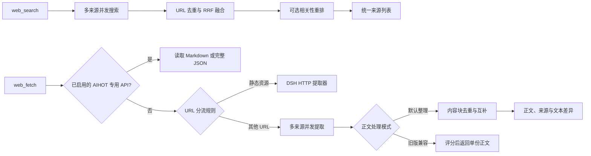

# dsh-web-search-fetch

[](./LICENSE)
[](./package.json)

**面向资料研究的 DSH 插件：融合多来源搜索，整理网页正文，保留来源与差异。**

面向 [DeepSeek Harness](https://github.com/deepseek-ai/deepseek-harness)（DSH）的网络搜索与网页提取插件。首次使用可通过 Firecrawl 官方匿名额度与 Bing RSS 开始，无需注册或填写 API Key；配置更多服务后，通过原生 `web_search` 融合搜索结果，通过原生 `web_fetch` 整理多份正文。适合技术检索与资料研究。

[快速开始](#快速开始) · [正文整理演示](./docs/content-organization.md#输入与输出演示) · [真实对比](./docs/modsearch-comparison.md) · [配置参考](./docs/configuration.md) · [参与贡献](./CONTRIBUTING.md)

```sh
dsh plugin --profile web add https://github.com/qikairo7/dsh-web-search-fetch/releases/download/v0.2.0/dsh-web-search-fetch-0.2.0.tgz
```

安装后重启 DSH，直接请求搜索或读取公开网页。匿名模式受服务方额度与限流约束，不能保证无限使用。未安装 DSH 的环境需先完成[宿主安装](https://github.com/deepseek-ai/deepseek-harness)。

## 项目特点

| 特点 | 当前实现 | 使用价值 |
| --- | --- | --- |
| 多来源搜索融合 | 最多 16 个搜索服务并发调用，按 URL 去重，使用 RRF（Reciprocal Rank Fusion）融合排名 | 将多路可用结果整理为统一来源列表 |
| 无需密钥首次体验 | 官方 Firecrawl Search / Scrape 未填密钥时使用匿名额度，Bing RSS 无需凭证 | 先完成一次搜索与提取，再按需增加服务 |
| 多来源正文整理 | 动态提取按章节和共同内容块去重、互补，保留提取来源及文本差异 | 将说明、表格、代码和独有段落整理到一份正文 |
| 原生双工具 | 仅注册搜索和提取 provider，不新增模型工具，也不需要额外 MCP 服务、浏览器自动化或外部 CLI | 沿用 DSH 的 `web_search`、`web_fetch` 调用方式 |
| 可选免费重排 | 调用硅基流动免费模型 `BAAI/bge-reranker-v2-m3`；不可用时保留融合顺序 | 对融合候选进行相关性排序，仍需配置 API Key |
| 服务统一管理 | DSH 凭证管理、服务开关、智谱通道选择，以及超时、取消、限流冷却和额度熔断 | 一处配置搜索、提取与重排；单路失败时继续使用其他可用结果 |
| 调用范围与预算 | 免费接口／均衡／深度／自定义预设，搜索与提取分别选择参与服务，限制请求次数与总限时 | 按任务控制调用范围，减少不需要的派发 |

插件注册两个 ID 为 `aggregated` 的 provider。设置页覆盖 18 项服务、16 个凭证位和 13 个扩展开关。静态资源使用 DSH 内置 HTTP 提取器，AIHOT 专用 API 直接读取；其余 URL 按配置进入多服务提取。

动态网页提取默认将同一 URL 的多路结果整理成一份正文：按章节和共同段落去重，补充独有内容，保留提取来源和文本差异。代码、表格、链接和原文数字保留；不同标题、明确版本标记、语言或返回目标的内容放入补充片段，识别出的登录与挑战页面不混入正文。引用式链接与脚注按来源保留完整 Markdown 原文，避免同名定义串用。可切换旧版单份正文模式。规则边界见[网页正文整理](./docs/content-organization.md)。

设置页可配置免费接口、均衡、深度检索和自定义预设，独立选择搜索／提取服务，并限制服务数量、HTTP 请求数、操作总限时和正文输出长度。保存后下一次调用生效；免费额度与付费服务不会自动纳入免费接口预设。

搜索融合和正文整理不构成事实交叉验证。多路并发会消耗对应服务额度。参数与使用边界见[配置参考](./docs/configuration.md)，离线验证方法见[正文整理](./docs/content-organization.md)。

与 ModSearch 5.10.6 的 48 次真实调用均成功。多服务搜索中，ModSearch 的耗时与请求次数更低；本插件融合来源并整理多份提取，适合需要来源与差异记录的资料研究。样本与限制见[真实对比](./docs/modsearch-comparison.md)。

## 完整接入清单

| 服务 | 搜索 | 网页提取 | 用途 |
| --- | --- | --- | --- |
| AnySearch AI | 支持 | 支持 | 搜索与正文提取 |
| 智谱 | 支持 | — | Anthropic 兼容通道与工具 API |
| 知乎 | 支持 | — | 内容搜索与额度查询 |
| Firecrawl | 支持 | 支持 | v2 Search 与 Scrape |
| Tavily | 支持 | 支持 | 搜索与 Extract |
| Exa | 支持 | 支持 | 搜索与 Contents |
| Keenable | 支持 | 支持 | 实时搜索与正文提取 |
| Crawl4AI Cloud | 支持 | 支持 | Cloud 搜索与 Scrape |
| GitHub | 支持 | 限定 URL | 公开仓库搜索，README / blob 文件提取 |
| 百度千帆 AI 搜索 | 支持 | — | 网页搜索 |
| 豆包 Custom | 支持 | 支持 | 搜索与 Fetch 分别配置凭证 |
| TinyFish | 支持 | 支持 | 独立 Search / Fetch API，共用密钥 |
| Serply | 支持 | 支持 | Google 搜索与 Markdown 提取 |
| Kimi | 支持 | 支持 | REST Basic / Pro 搜索与 Markdown 提取 |
| Bing RSS | 支持 | — | 匿名公开 RSS 搜索 |
| AIHOT | AI 资讯关键词 | 专用 API | 默认关闭，支持热点、事件、报告与精选读取 |
| 硅基流动 | 重排 | — | 融合结果相关性排序 |
| 直接 HTTP 抓取 | — | 静态资源 | 复用 DSH HTTP 组件，无需服务凭证 |

默认配置最多可调用 15 个搜索服务，AIHOT 默认关闭；启用 AIHOT 后最多 16 路。普通动态提取最多 10 路，适用的 GitHub URL 最多 11 路。Kimi Basic / Pro 二选一，只计一路。AIHOT 专用 API 直接读取，重排和 HTTP 抓取均不计入动态提取路数。实际参与调用的服务取决于配置、凭证、URL 适用范围及熔断状态。

智谱仅支持搜索，不包含阅读器。GitHub 提取限定仓库根 URL 和 `/blob/<ref>/<path>`。Bing RSS 使用公开搜索 feed，无需密钥；其可用性和格式可能变化。

AIHOT 搜索覆盖近 7 天 AI 资讯；启用后，原生 `web_fetch` 可读取热点、事件、日报、周报、月报、重置记录和精选快照／增量 API，不参与通用网页提取。使用方法见 [AIHOT 接入](./docs/aihot.md)。启用前请阅读 [AIHOT 使用规则](https://aihot.news/terms)；服务数据授权与本项目 MIT 代码许可分别适用。

### 服务费用

各服务可按免费服务、免费额度和付费使用区分。免费额度可能是每日／每月额度，也可能是限时试用或赠送额度。

| 费用方式 | 服务 | 说明 |
| --- | --- | --- |
| 免费服务 | TinyFish Search／Fetch、Bing RSS、GitHub 公开 API、直接 HTTP 抓取、硅基流动 `BAAI/bge-reranker-v2-m3` | 受请求频率、访问权限或资源限制约束；硅基流动仍需配置 API Key |
| 免费服务（有用途限制） | AIHOT | 个人非商业、公益非商业及组织内部使用；其他用途按服务规则授权 |
| 提供免费额度 | AnySearch、知乎、Firecrawl、Tavily、Exa、Keenable、Crawl4AI Cloud、Serply | 免费额度的有效期、重置周期和超额计费以服务方及账号为准 |
| 按次计费或付费订阅 | 智谱当前搜索通道、Kimi REST 搜索与提取 | Coding Plan 为付费订阅；`tools-api` 使用按次计费的 `search_pro`，套餐额度不属于免费额度；Kimi REST 接口按次计费，账号赠送额度需另行确认 |

Firecrawl 官方 Search / Scrape 支持 Keyless：未填密钥时不发送 Authorization；官方公布每月 1,000 免费 credits，实际使用仍受匿名限流及服务规则约束。填写密钥后使用对应账户额度，不因开启插件而保证免费；自定义端点仍需密钥。依据见 [Firecrawl Keyless 官方说明](https://www.firecrawl.dev/blog/firecrawl-keyless-launch)。免费接口预设仍排除 Firecrawl 等额度型服务。

百度千帆和豆包 Custom 的免费额度、赠送额度及开通条件需按对应账号确认。选择服务时，同时检查搜索与提取接口是否都在免费范围内。插件按配置并发调用，不自动按价格排序，也不保证只使用免费额度。

硅基流动重排使用免费模型 `BAAI/bge-reranker-v2-m3`，需要注册账号并配置 `SILICONFLOW_API_KEY`。注册入口：[硅基流动（邀请链接）](https://cloud.siliconflow.cn/i/E3nhNFP4)。模型费用以[硅基流动官方定价](https://siliconflow.cn/pricing)为准。

费用依据：[AnySearch](https://anysearch.com/pricing)、[知乎](https://developer.zhihu.com/)、[Firecrawl](https://www.firecrawl.dev/pricing)、[Tavily](https://www.tavily.com/pricing)、[Exa](https://exa.ai/pricing)、[Keenable](https://keenable.ai/)、[Crawl4AI](https://crawl4ai.com/)、[TinyFish](https://www.tinyfish.ai/pricing)、[Serply](https://serply.io/pricing)、[智谱 Coding Plan](https://docs.bigmodel.cn/cn/coding-plan/overview)、[Kimi REST 接口定价](https://platform.kimi.com/docs/pricing/websearch)。

## 快速开始

### 环境要求

| 组件 | 要求 |
| --- | --- |
| Node.js | `^22.19.0 \|\| >=24.0.0`，不包含 Node.js 23 |
| DSH | 已安装，并具有 `web` 和 `credentials` 服务 |
| 开发工具 | pnpm 12.10.1 |
| 外部服务 | 网络连通性；官方 Firecrawl 匿名模式与 Bing RSS 无需凭证，其他服务按需配置 |

开发依赖使用 DSH `0.2.1-alpha.2`。其他 DSH 版本的兼容性需实际验证。

### 使用发布包安装

在已配置 DSH 的环境中执行：

```sh
dsh plugin --profile web add https://github.com/qikairo7/dsh-web-search-fetch/releases/download/v0.2.0/dsh-web-search-fetch-0.2.0.tgz
```

将 `web` 替换为实际使用的 profile，安装后重启宿主。本项目通过 GitHub Release 分发固定版本包；此命令不需要 npm 包发布账号或 GitHub 登录。

### 从源码安装

在已配置 DSH 的环境中执行：

```sh
git clone https://github.com/qikairo7/dsh-web-search-fetch.git
cd dsh-web-search-fetch
pnpm install --frozen-lockfile
pnpm run build
dsh plugin --profile <profile> add link:<absolute-repository-path>
```

将 `<profile>` 替换为目标 profile，将 `<absolute-repository-path>` 替换为仓库绝对路径。路径包含空格时，对整个 `link:` 参数加引号。

bundle patch 自动选择 provider。使用以下命令检查装载后的配置：

```sh
dsh --profile <profile> --dump-config
```

应出现 `web-search-fetch` 条目，以及 `web` 条目下的 `searchProvider: aggregated` 和 `fetchProvider: aggregated`。配置输出仅证明装载状态；还需实际调用工具检查响应。分享输出前应检查其他插件的私密数据。

### 配置凭证

在 DSH Web 的「设置 → 内置插件 → 网络搜索与提取」中填写所需凭证并保存。空白填写位保持已有凭证；状态区只显示配置状态。

也可通过 DSH 凭证服务管理以下引用：

| 默认引用名 | 服务 |
| --- | --- |
| `ZHIPU_API_KEY` | 智谱搜索 |
| `ANYSEARCH_API_KEY` | AnySearch 搜索与提取 |
| `ZHIHU_ACCESS_SECRET` | 知乎搜索与额度查询 |
| `FIRECRAWL_API_KEY` | Firecrawl 搜索与提取 |
| `TAVILY_API_KEY` | Tavily |
| `EXA_API_KEY` | Exa |
| `KEENABLE_API_KEY` | Keenable |
| `CRAWL4AI_API_KEY` | Crawl4AI Cloud |
| `GITHUB_TOKEN` | GitHub |
| `QIANFAN_API_KEY` | 百度千帆 AI 搜索 |
| `DOUBAO_SEARCH_API_KEY` | 豆包搜索 |
| `DOUBAO_FETCH_API_KEY` | 豆包提取 |
| `TINYFISH_API_KEY` | TinyFish |
| `SERPLY_API_KEY` | Serply |
| `MOONSHOT_API_KEY` | Kimi 搜索与提取 |
| `SILICONFLOW_API_KEY` | 硅基流动重排 |

Bing RSS、AIHOT 和直接 HTTP 抓取无需凭证。豆包搜索与提取分别填写；Firecrawl 开关只控制搜索，官方网页提取在未配置密钥时使用匿名额度，配置密钥后使用账户额度。服务列表支持名称搜索、能力筛选和配置状态筛选；隐藏或折叠的草稿仍会保留。配置状态表示凭证存在，不证明服务健康。

配置文件只填写引用名。凭证值由 DSH 管理，每次操作重新解析。详细说明见[配置参考](./docs/configuration.md)。

### 使用

在启用本插件的 DSH 会话中使用原生工具，例如：

```text
搜索 DeepSeek Harness 的插件开发文档，并列出来源链接。
读取 https://example.com/guide.md，概括主要内容。
```

动态提取默认单个服务限时 45 秒。需为会话实际使用的 `tool-web` 设置足够的提取预算；Web agent preset 中的嵌套工具配置也需检查。见[工具超时配置](./docs/configuration.md#工具超时配置)。

## 设置界面

服务列表支持关键词搜索、能力筛选和逐项展开。保存前可以放弃修改；配置状态仅表示凭证是否存在。

## 工作原理



已启用的 AIHOT 专用 API 先直接读取，其他 URL 再进入分流。分流根据 URL 扩展名和配置的静态域名判断，不检测页面渲染能力。HTML、PDF、未知扩展名及无扩展名 URL 默认进入动态提取。静态提取失败时不会自动转入付费服务；动态提取失败时也不会自动回退到 HTTP。

## 文档

| 文档 | 内容 |
| --- | --- |
| [配置参考](./docs/configuration.md) | 参数、端点、凭证回落关系和工具预算 |
| [网页正文整理](./docs/content-organization.md) | 整理规则、来源标记、差异处理和限制 |
| [与 ModSearch 的真实对比](./docs/modsearch-comparison.md) | 方法、逐次指标、请求成本与证据边界 |
| [AIHOT 接入](./docs/aihot.md) | 原生工具读取 Markdown、结构化报告及精选 API |
| [架构说明](./DESIGN.md) | 模块职责、数据流、错误处理和扩展方式 |
| [术语表](./GLOSSARY.md) | 项目术语与接口含义 |
| [常见问题](./docs/troubleshooting.md) | 装载、凭证、超时和熔断排查 |
| [贡献指南](./CONTRIBUTING.md) | 本地开发、测试和提交要求 |
| [安全说明](./SECURITY.md) | 外部请求、凭证保护和漏洞报告 |

## 贡献与反馈

问题反馈和功能建议请通过 [GitHub Issues](https://github.com/qikairo7/dsh-web-search-fetch/issues) 提交。提交代码前请阅读[贡献指南](./CONTRIBUTING.md)。

## 许可与致谢

本项目采用 [MIT 许可](./LICENSE)。AnySearch 服务包含来自 [anysearch-team/anysearch-dsh](https://github.com/anysearch-team/anysearch-dsh) 的 MIT 代码；智谱通道参考了 [PartinGQAQ/dsh-web-search-zhipu](https://github.com/PartinGQAQ/dsh-web-search-zhipu) 的方法与协议常量。来源、改造范围和第三方许可全文见 [NOTICE](./NOTICE)。
