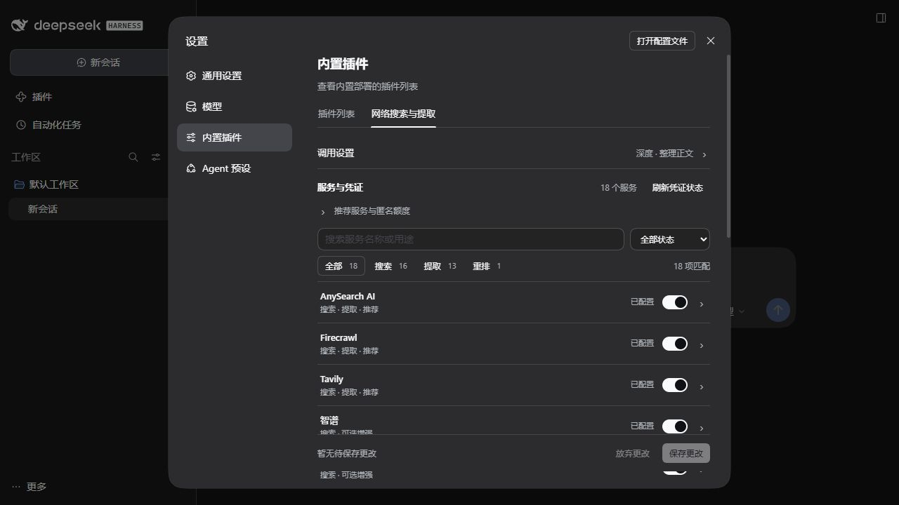

# 全服务隔离 profile 实测（2026-10-16）

## 结论与身份

后续豆包追查已确认并修复 HTTP → HTTPS 升级的目标判定缺陷，见[专项追查与实测](./doubao-fetch-20261016.md)。原两次 HTTPS 输入失败仍未确定根因；不可将新的 HTTP 样本当作原失败已归因。

18 项服务开关全部启用，18 个凭证槽位均已配置。按服务逐一调用真实 DSH 原生工具，并测试附加能力；40 个不同验收项的最近一次结果均为 PASS。候选包首次 39 项中 38 PASS、1 FAIL；豆包失败记录保留，重启同包 profile 后，12 项提取复测全部 PASS。最近一次通过不表示所有请求均成功。

| 对象 | 身份 |
| --- | --- |
| 基线主线／正式包 | 0.2.12，`1b854af9bb28360afcfe90b08a30aa88cd31ce6c` |
| 修复源码提交 | `f0979b66b11c5ac5d7ac1bd9edf21decda54b247` |
| 实测对象 | 本 PR 未发布候选包；包内版本标签仍为 0.2.12，不等同于已发布的 0.2.12 资产 |
| 候选包 SHA-256 | `ecc4a140509e5d7b7afd12505aa2d93d82bed6e7476a85f1c86ab0d1165bf6e8` |
| 环境 | Windows 11 build 26300、Node.js 24.20.0、DSH 0.2.1-alpha.3、pnpm 12.10.1 |

候选包编译代码的独立哈希、每项输入、耗时、来源数量、实际派发日志及失败历史见[脱敏指标](./all-services-20261016.json)。正式 Release 的安装、启动、GUI 保存与重启、卸载、0.2.11 回滚和恢复见[生命周期记录](./profile-lifecycle-20261016.md)。

## 方法

使用独立 DSH_HOME 的真实完整 Web profile。通过 DSH CLI 安装候选 tgz（禁用安装脚本），宿主原生 settings 服务保存服务开关与参与列表；宿主 ToolRuntime 执行 dsh-tool-web 注册的 web_search / web_fetch。每个单项只选一路，通过该路成功日志确认归属，随后再测试全部启用。未以聚合成功代替逐项验收，未让模型自主决定是否调用工具。

16 路搜索查询 DeepSeek Harness；GitHub 使用 repo:deepseek-ai/deepseek-harness，AIHOT 使用 DeepSeek。普通提取 URL 为 https://example.com，GitHub 使用公开仓库根页及 README blob 页。原生工具返回正文与来源标记才算提取通过。硅基流动重排另用实际客户端请求，核对服务 HTTP 200 和相关文档排序。

所有请求使用已有授权凭证及公开内容。公开证据仅含配置状态，不含密钥值、认证 URL、请求头或完整网页正文。耗时只是本机单次观察，不能用于服务排名。

## 逐服务原生工具结果

| 服务 | 单路搜索 | 单路动态提取 |
| --- | --- | --- |
| anysearch | PASS · 8 条 · 3080 ms | PASS · 1187 ms |
| zhipu | PASS · 8 条 · 8343 ms | 无该提取能力 |
| zhihu | PASS · 8 条 · 1082 ms | 无该提取能力 |
| firecrawl | PASS · 8 条 · 1461 ms | PASS · 2771 ms |
| tavily | PASS · 8 条 · 3259 ms | PASS · 903 ms |
| exa | PASS · 8 条 · 1392 ms | PASS · 1417 ms |
| keenable | PASS · 8 条 · 1188 ms | PASS · 5651 ms |
| crawl4ai | PASS · 8 条 · 1131 ms | PASS · 944 ms |
| github | PASS · 1 条 · 1594 ms | PASS · 902 ms |
| qianfan | PASS · 8 条 · 370 ms | 无该提取能力 |
| doubao | PASS · 8 条 · 419 ms | PASS · 1473 ms |
| tinyfish | PASS · 8 条 · 970 ms | PASS · 2747 ms |
| serply | PASS · 7 条 · 1619 ms | PASS · 2779 ms |
| kimi | PASS · 8 条 · 579 ms | PASS · 2698 ms |
| bing | PASS · 8 条 · 341 ms | 无该提取能力 |
| aihot | PASS · 8 条 · 386 ms | 无该提取能力 |

HTTP 和 siliconflow 不提供搜索结果，因此另测如下。知乎、智谱、千帆、Bing 无通用动态提取接口；AIHOT 使用专用 API 读取，不虚构通用网页提取能力。

## 附加能力

| 项目 | 结果 |
| --- | --- |
| Kimi Basic / Pro | 两种模式各自单独调用 PASS；Pro 已包含在上表 |
| GitHub blob README | 原生提取 PASS，确认进入 GitHub contents API |
| AIHOT JSON / Markdown | 两个专用 API 原生读取均 PASS |
| 静态 HTTP | 原生读取 RFC 9110 文本 PASS；100,000 字符上限触发预期截断 |
| 硅基流动重排 | 真实 HTTP 200；相关文档排在无关料理文档之前，顺序 [1,0] |
| 五种决策模型 | decision-model-preview、SemIf、Kev-4b、diffusiongemma、jev-latest 均在原生搜索说明中确认模型执行，且返回 8 条来源 |
| 全启用原生搜索 | 16/16 路成功，17 次插件 HTTP 请求（含重排），7,160 ms |
| 全启用普通网页提取 | 10/10 路成功，10 次插件 HTTP 请求，4,473 ms；GitHub 不匹配普通域名，单独测试 |

## 发现、修复与失败历史

1. GitHub 仓库根页成功取得 README，但返回 blob 地址，被正文整理视作其他目标而拒绝。修复只将同仓库 README 归属回请求的根页；跨仓库返回地址仍拒绝。
2. GitHub blob 的 .md 扩展名被误判为静态资源，绕过 GitHub API。已让符合参与、凭证、熔断条件的专用 URL 适配器优先于扩展名；显式 HTTP 路由与静态域名规则继续优先。
3. 上述两项均先用未修复代码复现测试 FAIL，修复后 PASS，并以实际原生提取复验。新增 5 项回归检查（含跨仓库拒绝及两种显式 HTTP 配置）。仓库 38 个测试文件、746 项测试、类型检查和仓库检查通过；106 项必要分发文件通过。
4. 基线逐项调用遇到 Firecrawl、Tavily 请求失败和 Keenable 超时；后续单路及候选包完整矩阵均 PASS，原始失败保留在 JSON。
5. 候选包豆包单路曾两次在正文整理阶段拒绝结果；HTTP 200 和 919 字符正文不能据此判作工具通过。直接适配器诊断成功；未更改包或放宽目标检查，重启同包 profile 后，豆包单路与全部 12 项提取复测均 PASS。重启后的诊断记录了输入 example.com、返回 example.com/、标题 Example Domain 和状态 200；首次失败时未捕获返回 URL，根因未确定，不声称已修复该现象或保证不会复发。

## GLM Coding Plan 通道

本轮正式验收的智谱通道为 `search.zhipuTransport: anthropic`，即插件默认的 Coding Plan 路径。单路搜索与 16 路聚合均通过。正式 profile 未设置该项，解析为相同默认值；未把正式 profile 切换到付费工具 API。

早期为扩展测试而显式选择的 `tools-api` 返回 HTTP 429、错误码 1113、余额不足。该通道与订阅通道不同，已从用户要求的验收矩阵排除；收到用户说明后未再调用。该失败不代表 Coding Plan 配置失败，也不能据此要求用户充值。本记录确认请求通道和工具结果，不声称已核对服务方实际账单。

## 设置界面与边界

NOT_RUN：其他 OS／DSH 版本完整生命周期、Git URL 直接安装、语言模型自主工具调用、账号账单和模型决策质量评测、DSH Store 独立供应链审阅与准入。已发布 0.2.12 不包含本 PR 的两处运行修复；本轮修复须合并并重新发布后才进入正式分发包。

## 后续状态

本节为事后补充，不修改上文的历史测量和边界。两处运行修复已合并，并进入 `0.2.13` 及之后的正式分发包；`0.2.14` 与 `0.2.13` 运行代码一致。语言模型自主调用后续已在 `0.2.13` 正式 DSH 会话中验证，见[实战验收](./live-session-20261016.md)。其他 OS／版本、账号账单和 Store 审阅边界仍保持 NOT_RUN。

候选包复测后再次通过 CLI 卸载；只移除本插件设置覆盖项，保留 1 项其他设置。完整 profile 重启后插件不存在，provider 恢复为 deepseek-official／http，原生 HTTP 提取 200（570 ms）。随后停止隔离服务，19816／19817／19818 无监听，删除隔离凭证库和代理环境副本，启动日志认证 URL 已脱敏。正式 DSH 的包与配置未被本轮命令替换。

独立 Spec 审阅无发现；Standards 审阅提出的配置文档缺少 GitHub blob 路由例外已补齐。新增 URL 适配器的未来扩展规则及筛选条件复用是维护建议，当前只有 GitHub 实现 supportsUrl，本轮未为此增加额外抽象。
