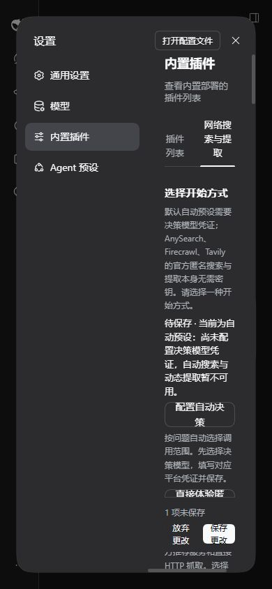
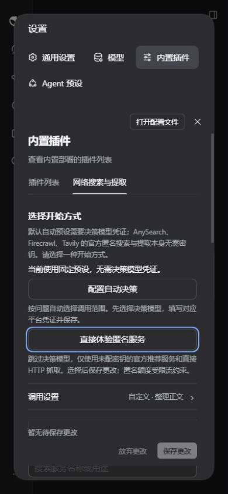
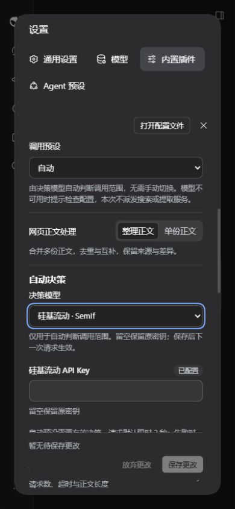
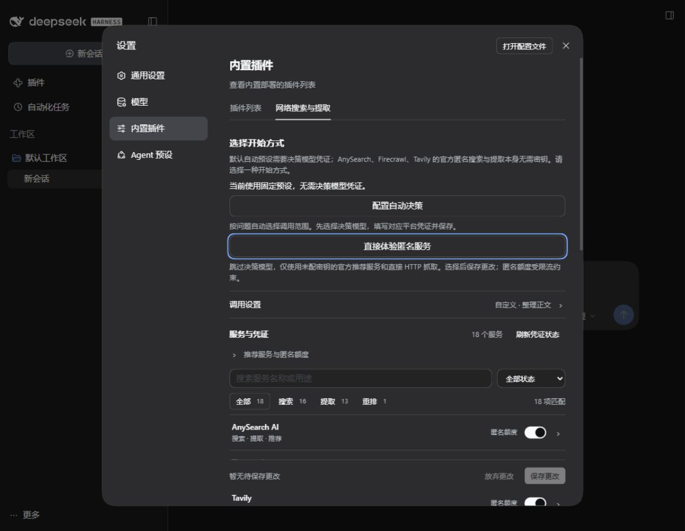

# 首次使用 GUI 验收

2026-10-16，Windows、DSH `0.2.1-alpha.3`，真实隔离 Web profile，在 Codex 内置浏览器中操作。使用实际插件客户端和宿主设置服务，不使用静态演示页。已有凭证只检查配置状态，没有输入或读取密钥值；本轮没有搜索、提取或决策模型接口调用。

## 发现与修复

1. 自动入口展开后焦点仍留在按钮，模型选择框可能落在可视区外。现在只在入口被激活后聚焦模型并居中滚动；正常更新不会抢走焦点。
2. 宿主设置侧栏在 390 像素视口仍占 188 像素，表单宽度不足，文字与按钮严重折行。现在视口不超过 600 像素且本插件表单挂载时，导航排到顶部；退出插件页面后恢复宿主布局。使用语义元素与本插件类名限定，不依赖宿主构建后的类名。

修复前：

修复后：

## 实际操作结果

| 项目 | 结果与证据 |
| --- | --- |
| 桌面视觉 | 1140 × 884；两个入口、当前预设与调用设置可读，保留宿主侧栏布局 |
| 窄屏 | 520 × 800、390 × 844、320 × 740；表单宽度分别为 419、289、219 像素；文档与控件无横向溢出，保存栏可见 |
| 自动入口 | Enter 激活后焦点为 `wsf-decision-model`，模型位于可视区，焦点环可见 |
| 模型与凭证 | 方向键从默认阿里模型切到 SemIf，Tab 到对应密码输入框；仅显示已配置状态，输入值为空 |
| 自然 Tab 顺序 | 从凭证输入到保存经过 48 个焦点位置，全程位于设置弹窗；Enter 保存成功 |
| 自动配置持久化 | 刷新后仍为 `auto` 和 `SemIf`，无未保存修改，密码输入为空；只验证保存，没有调用模型 |
| 匿名入口 | Space 激活后仅启用 AnySearch、Firecrawl、Tavily 与 HTTP，其他服务和重排关闭；Enter 保存成功，刷新后仍为自定义预设和这四个开关，无未保存修改 |
| 空结果与草稿 | 切换一个服务后输入长中文关键词，显示 0 项匹配与 1 项未保存；隐藏修改仍在全局计数中 |
| 键盘撤销 | Enter 放弃更改恢复开关；Enter 清除筛选恢复列表，草稿清零 |
| 样式作用域 | 切到通用设置时插件表单卸载、弹窗恢复原布局；回到本插件后窄屏重排生效 |

原始布局尺寸、Tab 顺序统计及客户端哈希见 [验收数据](./first-use-gui-20261016.json)。本次补齐先前未执行的视觉、键盘和窄屏检查；不代表实际屏幕阅读器、实体手机软键盘或所有浏览器组合均已验证。

原 HTTPS 历史问题继续暂停，未加载取证探针、未恢复自动跟进、未重复调用供应商接口。
