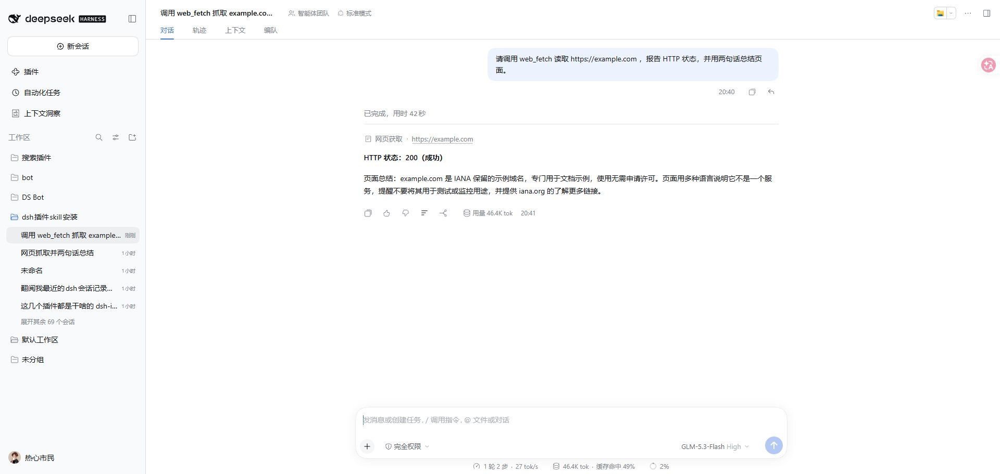

# 0.2.15 正式 profile 与 DSH alpha.4 适配验收（2026-10-16）

## 结论与身份

`0.2.15` 已完成 DSH `0.2.1-alpha.4` 适配、Release 发布、正式 Web profile 升级、宿主重启和原生 `web_fetch` 实测。alpha.4 的第三方插件兼容机制读取 `engines.dsh`；本插件声明 `>=0.2.1-alpha.2` 后正常装载，未触发兼容拒绝。

| 对象 | 身份 |
| --- | --- |
| 插件版本 | `0.2.15` |
| 安装包 | `dsh-web-search-fetch-0.2.15.tgz`，400,529 字节 |
| 安装包 SHA-256 | `60c73dc41c1dd36e375919e7f320e86211f3ebab9eb793d4974f12e8178f83ce` |
| Release | [`v0.2.15`](https://github.com/qikairo7/dsh-web-search-fetch/releases/tag/v0.2.15)，来源提交 `75c83bbbe93e8b939aa97dd6cf3d6f6c4bf12c23` |
| 目标环境 | 正式 `web` profile、DSH `0.2.1-alpha.4`、Node.js 24.20.0、Windows |
| 会话记录 | `session-c1c5f403-6c9d-4e1b-814b-ff17fff8c52e`，压缩日志 SHA-256 `80b7e24aae681f5328651c510bf233204f7a95ed0d8ce1cc25c18fc3c34409d8` |

正式 profile 的本地依赖从 `0.2.14.tgz` 更新为 `0.2.15.tgz`，两者均位于本机 DSH packages 目录。

## alpha.4 适配

DSH alpha.4 的第三方插件兼容性优先按 `engines.dsh` 判断。本版本做了以下适配：

| 项目 | 结果 |
| --- | --- |
| `engines.dsh` | 新增 `>=0.2.1-alpha.2` |
| `dsh.compatibility.dsh` | `0.2.1-alpha.4` |
| `dshReleases` | 新增 `0.2.1-alpha.4: compatible` |
| 开发运行包 | 10 个 DSH 开发依赖升级到 `0.2.1-alpha.4` |
| Cordis | 保持官方 alpha.4 依赖树使用的 `4.0.5-alpha.2` |
| Provider API | 对照 npm alpha.4 包，`@deepseek-ai/dsh-web` 的 provider 接口与 alpha.3 一致 |
| 插件运行代码 | 无需因 provider API 变化修改 |

适配检查基于 alpha.4 npm 包、TypeScript 编译和本仓库测试执行，不等同于完整 alpha.4 profile 生命周期验收。

## 安装、重启与装载

| 检查 | 状态 | 证据 |
| --- | --- | --- |
| Release 资产下载 | PASS | 本地安装包 SHA-256 与 `SHA256SUMS` 一致 |
| profile 升级 | PASS | CLI 输出 `dsh-web-search-fetch 0.2.14 -> 0.2.15` |
| 安装产物版本 | PASS | profile 内 `node_modules/dsh-web-search-fetch/package.json` 为 `0.2.15` |
| 编译入口身份 | PASS | `lib/index.js` 与 `client/index.js` 的 Git 对象哈希均与 `v0.2.15` 标签一致 |
| 兼容声明 | PASS | 安装产物声明 `engines.dsh: >=0.2.1-alpha.2`，兼容目标为 alpha.4 |
| provider 装载 | PASS | `dsh --profile web --dump-config` 中 `searchProvider` / `fetchProvider` 均为 `aggregated` |
| 本插件兼容状态 | PASS | alpha.4 未报告本插件不兼容 |
| 宿主重启 | PASS | 停止旧进程后重新启动；新进程监听 3080，DSH Web 登录页可用 |
| 正式会话 | PASS | 模型调用原生 `web_fetch`，轮次 `completed` |

## 原生提取结果

验证输入为公开页面 `https://example.com`。用户消息要求调用 `web_fetch`、报告 HTTP 状态并用两句话总结页面。

| 指标 | 结果 |
| --- | --- |
| 原生工具调用 | `web_fetch` |
| 工具状态 | HTTP 200 |
| 提取服务 | Firecrawl、AnySearch、Tavily 三路均返回 200 |
| 返回 URL | 三路均为 `https://example.com` |
| 上游截断 | 三路均未标记截断 |
| 自动决策 | `jev-1.13.0` 判定 fast，置信度 89% |
| 提取范围 | 仅派发 3 路，未派发其余 7 路 |
| 插件 HTTP 请求 | 4 次 |
| 正文整理 | 输出含 `F#:B#` 提取来源与多语言内容块 |
| 轮次状态 | `turn/end.reason.kind = completed` |

Firecrawl、AnySearch、Tavily 的接收时间分别为 `2026-10-16T12:41:24.685Z`、`12:41:22.869Z`、`12:41:24.999Z`。这些时间为单次观察，不用于性能排名。

## 第三方插件兼容边界

alpha.4 宿主拒绝装载两个与本插件无关的第三方插件：

- `@michengai/dsh-skills-manager@1.1.23`
- `@michengai/dsh-archive-manager@1.0.20`

拒绝原因是二者的 peer 依赖范围未包含 DSH `0.2.1-alpha.4`。DSH 提示可通过 exact-version exemption 接受风险；本轮未授予该豁免，因为这是对其他插件明确风险的宿主配置决定。该边界不影响本插件装载和原生 `web_fetch` 调用。

启动日志仍出现既有 MiniMax 账号 signed-out 错误；`--dump-config` 仍有既有 `subagent-claude-code` patch 警告。二者均与本插件无关。

## 仓库验证与边界

- PASS：`pnpm run check`，41 个测试文件 / 771 项测试、构建、类型检查与仓库检查。
- PASS：`pnpm run check:distribution`，106 个必要分发文件。
- PASS：`npm pack --dry-run`，129 个文件、400.4 kB。
- PASS：PR 与主线 CI，Windows／Ubuntu × Node.js 22.19／24。
- NOT_RUN：alpha.4 下的完整生命周期、设置页保存、卸载、回滚、逐服务矩阵和 `web_search`。
- `web_search` 既有正式会话证据见[实战验收](./live-session-20261016.md)；本记录不把 0.2.14 或 0.2.13 的运行结论自动扩展为 alpha.4 完整矩阵。
