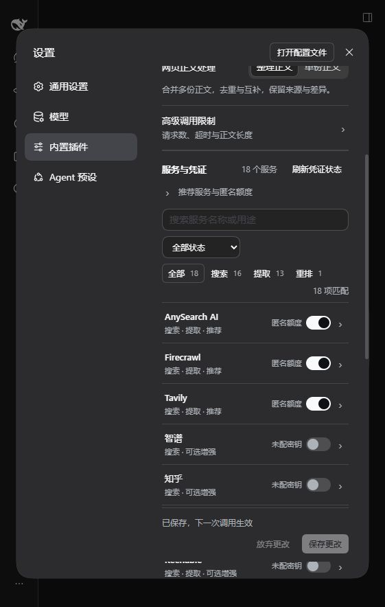
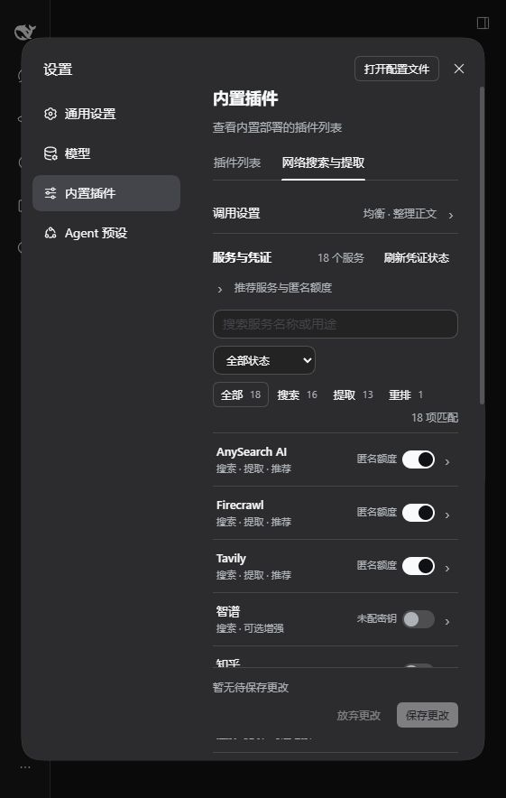
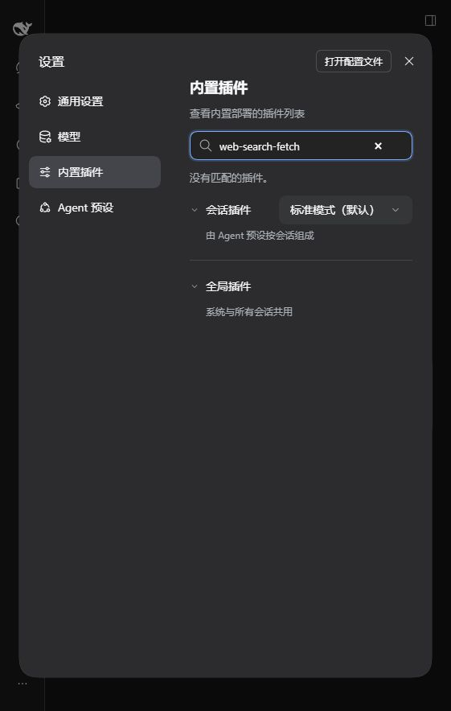

# 0.2.12 隔离 profile 生命周期验收

## 结论与版本

2026-10-16，`0.2.12` 在 Windows 11、Node.js 24.20.0、DSH 0.2.1-alpha.3、pnpm 12.10.1 上完成实际隔离 profile 验收。使用独立 `DSH_HOME`、Web profile 和端口，不复制正式 profile 的插件组合。包安装使用 DSH CLI；运行依赖通过 pnpm 正常安装，可复用内容寻址缓存。

| 对象 | 身份 |
| --- | --- |
| 当时主线／0.2.12 固定源码 | `1b854af9bb28360afcfe90b08a30aa88cd31ce6c` |
| 回滚目标／0.2.11 固定源码 | `ab6387f04a85debff70e89f07925703cdb933cb1` |
| Release 包 | `dsh-web-search-fetch-0.2.12.tgz`，256,833 字节 |
| Release SHA-256 | `d61d465c4b8fadd6f95d849367d9887efa3210f34276818067c6c8bc67bdd243` |

Release 身份与 [GitHub Release](https://github.com/qikairo7/dsh-web-search-fetch/releases/tag/v0.2.12) 的资产 digest 对照一致。本机两种网络栈下载均遇到 TLS 连接失败，因此使用已缓存、逐字节哈希匹配的正式包。本次不声称重新从 GitHub 完成下载。

## 已执行检查

| 检查 | 状态 | 实际证据 |
| --- | --- | --- |
| 安装前基线 | PASS | 原始 Web profile 的 provider 为 `deepseek-official`／`http`，无本插件 |
| Release 安装 | PASS | `dsh plugin --profile web add file:./dsh-web-search-fetch-0.2.12.tgz --ignore-scripts` 退出 0；安装版本 0.2.12，两个 provider 均为 `aggregated` |
| 固定 Git 树安装 | PASS | 对主线固定提交执行 `git archive` 后，DSH CLI 以 `file:` 安装导出目录并禁用生命周期脚本；目录无 `node_modules`，安装后未构建即可启动 |
| 实际 CLI 启动 | PASS | 使用 DSH CLI 的 `--profile web --host 127.0.0.1 --port 19816 --no-open`；认证交换 303，携带会话 cookie 后主页 200，标题为 DeepSeek Harness；四项 JS／CSS 资源均为 200 |
| 自动预设搜索 | PASS | 原生 `web_search` 查询 Node.js ECMAScript modules 官方文档，返回 8 条来源；说明记录外部决策结果及实际服务数量 |
| 自动预设动态提取 | PASS | 原生 `web_fetch` 读取 `https://nodejs.org/api/esm.html`，返回 HTTP 200、正文与 `F#:B#` 提取来源标记 |
| GUI 设置保存 | PASS | 实际设置卡片将自动预设改为均衡；显示「已保存，下一次调用生效」；下一次原生搜索返回 8 条来源，操作说明不再包含决策模型步骤 |
| 设置持久化 | PASS | 刷新页面，并停止后通过真实 DSH CLI 重新启动；卡片仍显示均衡、整理正文，且无待保存草稿；隔离凭证库中的既有决策凭证值保持不变 |
| 卸载与清理 | PASS | CLI remove 后包及 bundle 消失；只清理本插件保存的覆盖项，其他设置保留；配置无遗留警告，provider 与安装前一致 |
| 卸载后实际运行 | PASS | profile 可重新启动；原生 `web_fetch` 读取 `https://example.com` 返回 HTTP 200；设置页无本插件卡片，搜索插件 ID 显示无匹配 |
| 版本回滚与恢复 | PASS | `0.2.12 → 0.2.11 → 0.2.12` 均通过 CLI 安装、真实 profile 启动及原生搜索／提取；均衡设置保留 |
| 最终恢复 | PASS | 最终移除本插件，恢复默认 provider，原生 HTTP 提取通过；临时服务停止，三个验收端口释放 |

原生工具检查在实际启动的完整 Web profile 中，使用宿主 `@deepseek-ai/dsh-tools` 执行 `@deepseek-ai/dsh-tool-web` 注册的工具，复用该 profile 的真实 provider、凭证和设置服务。没有直接调用本仓库的搜索或提取实现，没有用 mock 服务替代外部接口。工具由验收程序确定性调用，不声称由语言模型自主选择工具。

真实请求仅包含公开查询和公开 URL。三家默认推荐服务使用匿名额度；自动预设使用已有的决策凭证。凭证值和认证 URL 不进入本记录或公开指标。总耗时仅为对应样本的观察结果，不用于性能比较。

## 回滚实测指标

下表中的各次调用查询 `DeepSeek Harness`、提取 `https://example.com`。详细运行状态及退出条件见[脱敏指标](./profile-lifecycle-20261016.json)。

| 安装阶段 | 搜索来源 | 搜索耗时 | 提取状态 | 提取耗时 |
| --- | --- | --- | --- | --- |
| 0.2.12 固定 Git 导出 | 8 | 2,562 ms | HTTP 200，含来源标记 | 2,546 ms |
| 回滚到 0.2.11 | 8 | 5,436 ms | HTTP 200，含来源标记 | 1,016 ms |
| 恢复 0.2.12 Release | 8 | 4,388 ms | HTTP 200，含来源标记 | 1,108 ms |
| 最终卸载后 | 不适用 | 不适用 | 原 HTTP provider，HTTP 200 | 570 ms |

## 发现与处理

DSH 0.2.1-alpha.3 的 CLI remove 移除包和 bundle，但保留设置页写入 profile patch 的 `web-search-fetch` 覆盖项。本次实际出现 `patch: entry "web-search-fetch" not found`。清理该覆盖项后，警告消失，其他设置保留，provider 恢复为安装前的值。

这是宿主保留用户覆盖项的行为。本轮修正目标 profile 并补充[卸载与回滚步骤](../lifecycle.md)，未给插件增加卸载时删除用户设置的逻辑，也未修改已发布包或宿主代码。另修正 README 安装命令后遗留的旧版本号。

## 界面证据

保存后的界面：

通过真实 CLI 重新启动后的界面：

最终卸载后的界面：

## 验证边界

- NOT_RUN：通过 GitHub Git URL 直接安装；固定源码路径验证采用同一提交的 `git archive` 导出和本地 `file:` 安装。
- NOT_RUN：其他操作系统及其他 DSH 版本的完整 profile 生命周期，不扩大 manifest 兼容声明。
- 本记录的原始调用只覆盖三家推荐服务。后续已补齐[全服务逐项实测](./all-services-20261016.md)，包含单独标识的未发布 PR 候选包；不能把候选包修复视为已发布 0.2.12 的行为。
- NOT_RUN：语言模型自主调用。卸载后默认搜索 provider 的账户调用不在本次范围内。
- NOT_RUN：Store 独立供应链审阅及准入，仍以 [#1415](https://github.com/AI-Scarlett/DSH-Store/issues/1415) 的维护者结论为准。
- 本轮未替换正式 profile 的包或配置；验收结束时正式 Web 服务仍由原进程提供服务。

本记录绑定上述源码和分发包。后续版本或宿主变化时，应重新验证受影响步骤。

事后补充：语言模型自主调用已在 `0.2.13` 正式 DSH 会话中验证，见[实战验收](./live-session-20261016.md)；`0.2.14` 另完成正式 Web profile 升级与重启验证，见[正式安装验证](./formal-profile-v0.2.14-20261016.md)。这两条后续证据不扩大本记录的卸载、回滚和兼容范围。

## 仓库检查与清理

- PASS：`pnpm run check:distribution`，106 项必要分发文件通过。
- PASS：`pnpm run check`，38 个测试文件、741 项测试、类型检查和仓库检查通过。
- PASS：`git diff --exit-code -- lib`，构建产物与固定主线一致。
- PASS：`git diff --check`，无空白错误。
- 已删除任务创建的 Git 导出工作目录，避免副本测试被 Vitest 重复发现。
- 已删除隔离环境中的凭证库副本和代理环境副本，启动日志中的认证 URL 已脱敏；保留非敏感验收指标、公开页面结果及配置备份供复查。
